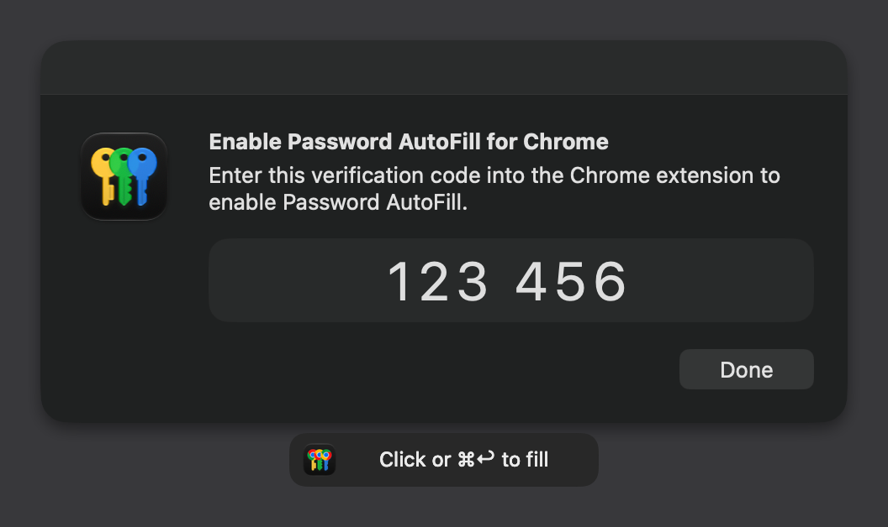
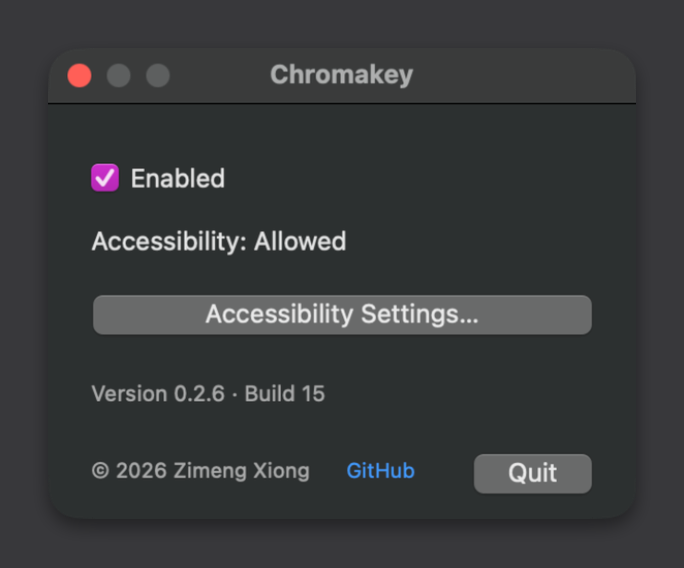

# Chromakey

Apple Passwords is so frickin annoying about making you type a code from one window into another. Chromakey fills it in for you. Click the overlay or press Command–Return. It works with Chrome and Helium.





```sh
brew install --cask zimengxiong/tools/verification-code-shortcut
```
